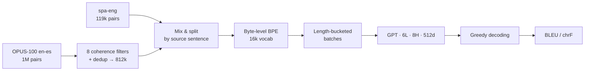
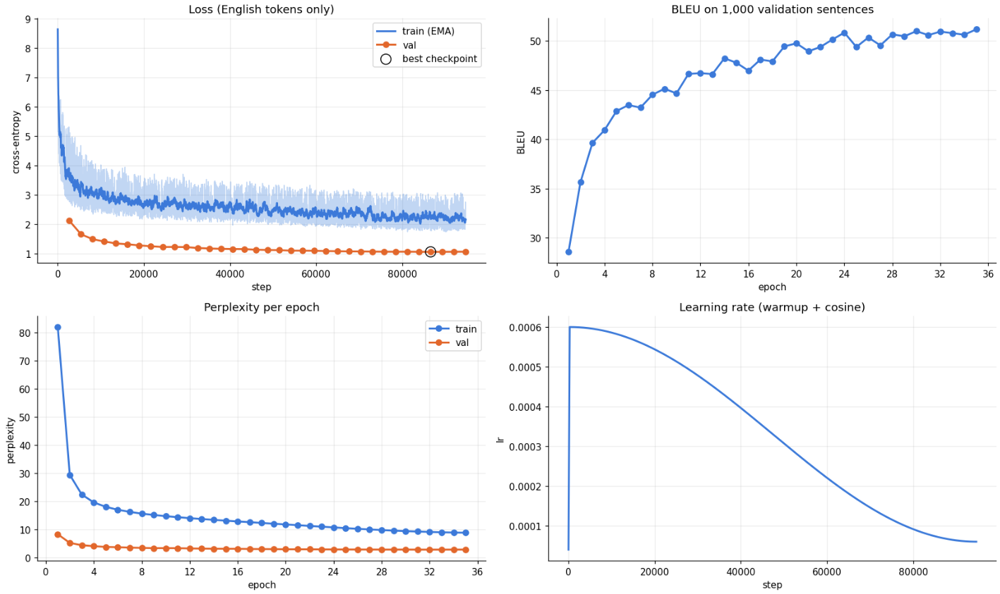
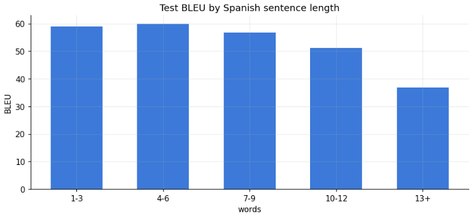
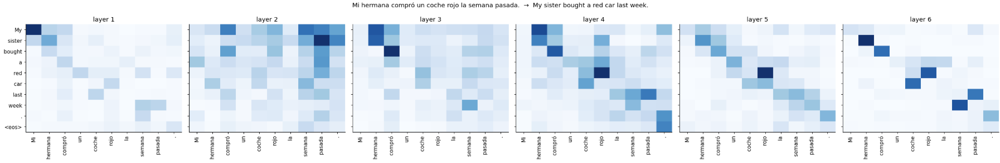

# Spanish → English Translation with a GPT Trained from Scratch

A decoder-only Transformer (minGPT-style, **27M params**) trained from scratch to translate Spanish into English. Translation is treated as conditional language modeling.

<p align="center">
  <b>Test BLEU 52.4</b> · <b>chrF 67.8</b> · 2× Tesla T4 · 133 min
</p>

## Pipeline



Each pair becomes a single sequence. The loss is computed **only on the English side**:

```
<es> ¿Dónde está la estación? <en> Where is the station? <eos>
 ·    ·     ·    ·     ·       ✓    ✓     ✓   ✓     ✓      ✓
```

## Data

| Split | spa-eng | OPUS-100 | Total |
|---|---:|---:|---:|
| train | 107k | 596k | 703k |
| val | 5.9k | 1.8k | 7.7k |
| test | 5.9k | 1.7k | 7.7k |

- OPUS-100 is cleaned before use. The filters remove empty, untranslated, URL/markup, song lyrics, low-letter, too-long (>40 words), length-ratio outliers (outside [0.5, 2.0]), and wrong-language pairs.
- The data is split by **Spanish source sentence**, so no source appears in more than one split.
- Pairs longer than the 96-token context are dropped. This keeps 98.4% of train.

## Model & training

| | |
|---|---|
| Architecture | 6 layers · 8 heads · d=512 · context 96 · tied embeddings |
| Regularization | dropout 0.1 · label smoothing 0.1 · weight decay 0.1 |
| Optimizer | AdamW (β = 0.9, 0.95) · lr 6e-4 · 300-step warmup → cosine to 10% |
| Batch | 256 · fp16 AMP · grad clip 1.0 · `DataParallel` on 2× T4 |
| Stopping | early stopping on val loss (patience 3) · best epoch 32 / 35 |

**Length-bucketed sampling.** Within buckets of 100 batches, sentences are sorted by length. Padding drops from **71% → 1.7%**, so each epoch processes **3.4× fewer tokens**.



## Results

| Split | BLEU | chrF |
|---|---:|---:|
| val | 52.14 | 67.59 |
| test | **52.41** | **67.81** |



| Spanish | Model |
|---|---|
| Mañana voy a entrenar mi propio modelo de lenguaje. | Tomorrow I'm going to train my own language model. |
| Si llueve mañana, nos quedaremos en casa. | If it rains tomorrow, we'll stay at home. |
| Las noches son oscuras, pero el día es claro. | The nights are dark, but the day is clear. |
| Barcelona es el mejor equipo del mundo. | Barney's best team. ❌ |

The model struggles with proper nouns and sentences longer than 13 words.



## GPT from scratch vs. pretrained GPT-2

`spanish_to_english_gpt2.ipynb` uses the same `GPT` class. It loads DistilGPT-2 weights into it and fine-tunes on the same task.

| | GPT (scratch) | DistilGPT-2 + fine-tuning |
|---|---:|---:|
| Params | 27M | 82M |
| Tokenizer | BPE 16k (es+en) | GPT-2 BPE 50k |
| Test BLEU | 52.41 | — |
| Test chrF | 67.81 | — |

## Run

1. Open the notebooks on Kaggle and set **Accelerator: GPU T4 ×2** and **Internet: on**.
2. Attach the [spa-eng](https://www.manythings.org/anki/) dataset. OPUS-100 downloads from Hugging Face.
3. Run all cells. The notebook writes `best_model.pt` and `tokenizer.json` to `/kaggle/working`.

```
├── spanish_to_english_my_gpt.ipynb   # GPT from scratch
├── spanish_to_english_gpt2.ipynb     # DistilGPT-2 fine-tuning + comparison
└── assets/
```
